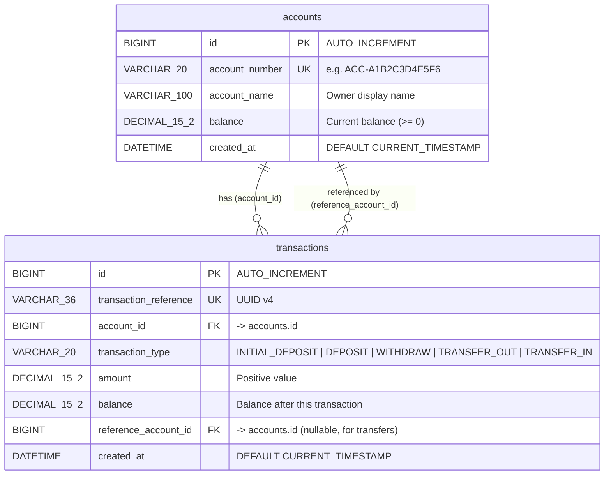

# Database Layout – BankingSystem_CIICC

---

## Entity-Relationship Diagram



---

## Table Definitions

### `accounts`

| Column           | Type            | Constraints              | Description                        |
|------------------|-----------------|--------------------------|------------------------------------|
| `id`             | `BIGINT`        | PK, AUTO_INCREMENT       | Surrogate primary key              |
| `account_number` | `VARCHAR(20)`   | NOT NULL, UNIQUE         | Human-readable account identifier  |
| `account_name`   | `VARCHAR(100)`  | NOT NULL                 | Account holder name                |
| `balance`        | `DECIMAL(15,2)` | NOT NULL, DEFAULT 0.00   | Current balance (max 13 digits)    |
| `created_at`     | `DATETIME`      | NOT NULL, DEFAULT NOW()  | Record creation timestamp          |

### `transactions`

| Column                 | Type            | Constraints               | Description                                       |
|------------------------|-----------------|---------------------------|---------------------------------------------------|
| `id`                   | `BIGINT`        | PK, AUTO_INCREMENT        | Surrogate primary key                             |
| `transaction_reference`| `VARCHAR(36)`   | NOT NULL, UNIQUE          | UUID — idempotency / audit key                    |
| `account_id`           | `BIGINT`        | NOT NULL, FK → accounts   | Owner of this ledger entry                        |
| `transaction_type`     | `VARCHAR(20)`   | NOT NULL                  | INITIAL_DEPOSIT · DEPOSIT · WITHDRAW · TRANSFER_OUT · TRANSFER_IN |
| `amount`               | `DECIMAL(15,2)` | NOT NULL                  | Absolute value of the movement                    |
| `balance`              | `DECIMAL(15,2)` | NOT NULL                  | Account balance **after** this transaction        |
| `reference_account_id` | `BIGINT`        | NULL, FK → accounts       | Counter-party account (transfers only)            |
| `created_at`           | `DATETIME`      | NOT NULL, DEFAULT NOW()   | Record creation timestamp                         |

---

## Transaction Types

| Type              | Affects `account_id` | `reference_account_id` |
|-------------------|----------------------|------------------------|
| `INITIAL_DEPOSIT` | Credit (open)        | NULL                   |
| `DEPOSIT`         | Credit               | NULL                   |
| `WITHDRAW`        | Debit                | NULL                   |
| `TRANSFER_OUT`    | Debit (sender)       | Receiver account ID    |
| `TRANSFER_IN`     | Credit (receiver)    | Sender account ID      |

> A transfer always creates **two** rows — one `TRANSFER_OUT` row and one `TRANSFER_IN` row — sharing the same `transaction_reference` UUID so they can be correlated.

---

## Indexes (recommended)

```sql
-- Already implied by PK and UNIQUE constraints:
--   PRIMARY KEY (id)
--   UNIQUE KEY (account_number)          on accounts
--   UNIQUE KEY (transaction_reference)   on transactions

-- Additional performance index:
CREATE INDEX idx_transactions_account_id
    ON transactions (account_id, created_at DESC);
```
